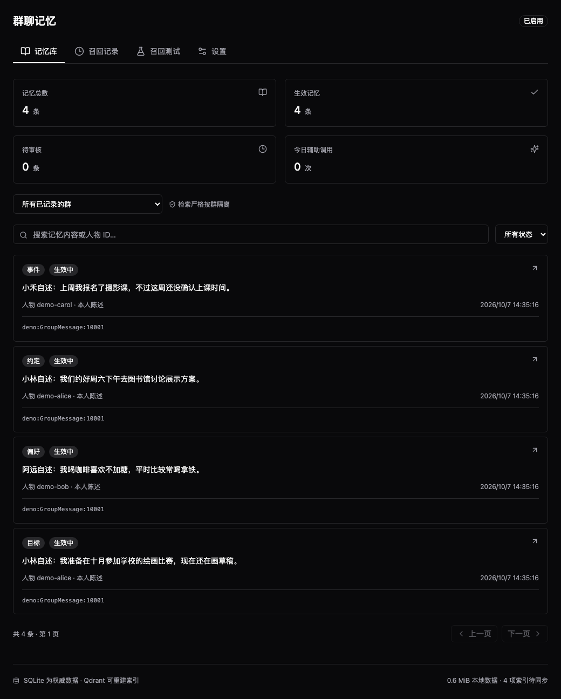
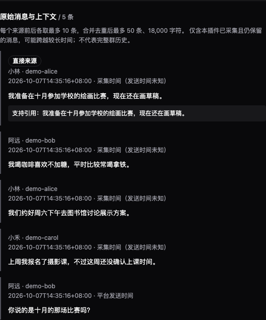

# Eyewitness Memory · 群聊记忆

让 AstrBot 在群聊里记住群友聊过的事，并在每次引用前翻回当时的原话核对。

举个例子，群友小林某天随口说了一句：

> 我准备在十月参加学校的绘画比赛，现在还在画草稿。

过了几周，有人在群里问机器人：「小林之前说的比赛是什么时候？」插件会从本群记忆库里找出这条线索，连同当时前后的聊天记录一起交给辅助模型核对。模型判断原话能支持这条记忆、没有明显玩笑或否定语境后，才会把这条记忆和原话片段递给主聊天模型作参考。

**群友平时照常聊天就行，不用发专门的记忆指令，也不需要主聊天模型自己调用工具。**

目前仅支持 **QQ OneBot 群聊（aiocqhttp）** 和 **QQ 官方机器人群聊**，不支持私聊。它只管记忆，不会让机器人主动插话，只在机器人本来就要回复时顺手查记忆。另外，插件只能从启用后开始记录新消息，没法拉取安装前的历史记录；QQ 官方机器人也只能记录平台实际投递过来的消息。



*管理页面实拍。本文截图均使用虚构人物和演示数据，不含真实群聊。*

## 它能帮你做什么

- **记住日常聊过的事**：自动从群聊里整理群友的偏好、计划、事件和约定（比如「喝咖啡不加糖」「十月参加绘画比赛」）。
- **用前先核对原话**：每条记忆都绑着当时的原话来源，回答前先结合前后聊天核实，防传话走样或把玩笑当真。
- **各群记忆严格隔离**：A 群聊过的事不会带到 B 群；平时用 `reset` 重置普通对话，也不会把记忆库清空。
- **自带网页管理后台**：直接在网页里查看、搜索、修改、停用或删除记忆，还能随时测试一句话能查出什么。

## 快速上手

需要 **AstrBot 4.28.1 及以上的 4.x 版本（Python 3.11+）**，并已接好 QQ 群聊和聊天模型。

### 1. 安装插件

在 AstrBot 插件管理中通过仓库地址安装：

```text
https://github.com/camera-2018/astrbot_plugin_eyewitness_memory
```

### 2. 最少配好这三项

插件新装后**默认关闭**，白名单也是空的，不会自动记录所有群。打开插件配置填好下面三项即可开始使用：

| 设置项 | 怎么填 |
| --- | --- |
| **辅助模型** | 从 AstrBot 已配好的聊天模型里选一个。负责提取记忆和核对原话，普通聊天模型就能用（需支持返回 JSON，可与主聊天模型不同）。 |
| **允许记录的群** | 填入完整的群会话标识，例如 `default:GroupMessage:123456`（把 `default` 换成实际平台标识，`123456` 换成群号；QQ 官方机器人填群 OpenID。不能只填纯数字群号）。 |
| **插件开关** | 改为「启用」并保存。建议先拿一个熟悉的群试水。 |

- **群里有其他机器人？** 把它们的账号填进「其他机器人 ID」，免得把别的机器人的回复当成群友记忆。
- **开启 JSON 模式（可选）**：如果所选辅助模型走的是明确支持 `response_format=json_object` 的 OpenAI 兼容接口，可以打开「请求 JSON 对象输出」，让输出格式更稳；不确定就保持默认关闭。

## 到哪里看记忆、原话和报错

在 AstrBot 后台左侧点开「插件页面」，进入 **群聊记忆**。管理页直接沿用 AstrBot 的登录状态，**不用额外开端口，也不用配独立密码或 Token**。



- **记忆库与原话**：点开任意一条记忆，都能看到标着「直接来源」的那句原话，以及当时前后各最多 **10 条**附近聊天（带昵称、账号 ID 和发送时间）。
  - **生效中**：未过期时可参与检索，每次用前仍会再核对一次原话。
  - **待审核**：群友转述他人等不便直接采信的内容会进这里，不会直接拿去回复；你对照原话确认无误后可手动改为生效。
  - **已停用**：不再参与检索，但仍留在列表里，随时可以恢复。
- **召回记录与召回测试**：想看机器人刚才为什么用了（或没用）某条记忆，去「召回记录」就能看到每一步找到了什么、耗时多少、为什么跳过。也可以在「召回测试」里输入一句话模拟提问，它只会展示查找结果，不会往群里发消息。
- **失败提取与用量统计**：如果某批聊天因为模型超时或报错没提取成功，会留在「失败提取」里。为免同一批聊天反复报错扣费，**插件不会自动重试失败请求**；等你确认模型恢复正常后，手动点一下「重新提取」就行。首页还能看最近 24 小时的调用次数与 Token 统计。

## 平时是怎么工作的

1. **后台攒够一批再提取**：插件不会群里每发一句话就调一次模型。默认攒够 **80 条待处理消息**，或者最早一条消息等满 **15 分钟**后，先在本地滤掉纯表情和重复刷屏，再把这批聊天交给辅助模型提取记忆。
2. **回复前先搜后核**：当机器人准备回复群消息时，默认会先让辅助模型结合最近对话和回复引用理解问题（最多补充 **3 条**检索线索），在当前群搜出最多 **24 条**候选摘要，挑出最多 **6 条**去翻当时的原话和上下文。
3. **少量精准注入**：只有核对通过的记忆，才会连同原话片段附在本轮用户消息末尾交给主模型参考（普通问题单轮最多塞入 **2 条**记忆，人物简介类问题可按不同信息类别保留多条，默认最多等待 **30 秒**、不超过 **8000 字符**）。如果当前对话上下文快满了，会自动缩减周边对话或干脆跳过记忆，避免继续挤占主聊天的上下文。

## 可选进阶功能

基础功能只需一个辅助模型就能跑通。如果你有更高的检索或整理需求，可以按需打开下面的开关：

<details>
<summary>1. 语义检索（Embedding + Qdrant）：换种说法也能搜到</summary>

默认情况下，插件靠关键词和群友身份匹配记忆。如果你希望有人问「平时喝什么提神」也能联想到「喜欢冰美式」，可以同时配好这两项：

- **Embedding 模型**：在下拉框选择 AstrBot 里已配置好的向量模型（刚加的模型需重载插件刷新列表）。
- **Qdrant URL**：填入向量库地址，例如 `http://qdrant:6333`（有鉴权可填 API Key；Collection 前缀默认 `eyewitness_memory_v1`，必须以 `eyewitness_memory_` 开头，请勿与其他插件共用）。

两边都填好后自动启用语义检索。「纯语义候选最低分」默认是 `0.55`——它只是向量相似度的初筛门槛，不是准确率；换用不同向量模型后分数高低会有差异，可按实际效果微调。

</details>

<details>
<summary>2. System One / FastBrain：更快判断要不要查记忆、帮忙筛候选</summary>

如果你接入了支持 **System One 决策接口** 的模型（如 `FastBrain-9B`、`jev-1.13.0`、`clef-flash`），可以让它帮辅助模型打前站。**它负责判断是否需要记忆、整理检索线索和筛选候选，最终事实核验依然由辅助模型对照原话完成；一旦不确定、超时或报错都会保守继续常规流程，不会乱丢候选。**

**怎么接入（二选一）：**
- **AstrBot 官方决策接口（推荐，需 AstrBot 4.29.4+）**：先在 AstrBot「模型提供商 → 决策模型」中添加 System One 提供商，再在插件里填写 **「AstrBot 官方 System One 决策提供商 ID」**（`systemone_decision_provider_id`）和 **「System One 模型名」**（需与提供商里的模型名一致）。地址和密钥由 AstrBot 统一管理；留空此项则使用下面的旧版 HTTP 接法。*注：官方接口不返回 Token 用量，面板统计里会记为未知。*
- **旧版 HTTP 兼容接法**：在「System One 提供方」（`systemone_provider_id`）里选一个已有的提供方以复用其地址和密钥，再填好模型名与接口路径（默认 `/typesafe/v1/systemone`；部分网关使用 `/fastbrain/v1/systemone` 或 `/clef/v1/systemone`，直连服务通常用 `/v1/systemone`，以所接服务为准）。

**常用开关说明：**
- **候选排序与原文初核**：配好模型后即可在核验前给候选排序（默认上限 `3` 秒）。其中「System One 原文初核」默认开启；**如果用的是 FastBrain，建议关闭「System One 原文初核」**，只用它做相关性排序即可。
- **FastBrain 召回前置判断**（`recall_gate_enabled`，默认关闭）：回复前先花最多 `3` 秒判断这轮话需不需要翻旧账。只有模型很有把握认为不需要（默认跳过分数门槛 `0.85`，这是模型打分而非真实准确率）、回答不需要补充过去的人物、配置或群聊事实，且当前问题完整、没有缺失的引用原文时，才直接跳过查记忆；拿不准就照常检索。提到人名或软件本身不会强制查记忆，比如「给小王写祝福」与「小王以前学什么专业」会分开判断。
- **FastBrain 检索规划与候选筛选**（`recall_fast_path_enabled`，默认关闭）：配合前置判断开启后，挑选近期对话线索和初筛候选池（最多 24 条）的工作改由 FastBrain 完成，辅助模型只做最后一步原话核验，省去前两步辅助模型调用。
- **共享 FastBrain 优先队列**（`fastbrain_priority_enabled`，默认关闭）：如果同一个 AstrBot 进程里还装了共用同一 FastBrain 接口的另一个插件（如主动回复插件），两边同时打开此开关后，会让「召回前置判断」优先执行（最多连续插队 3 条后放行 1 条普通请求），减少回复前的排队。

</details>

<details>
<summary>3. 定时整理记忆：自动清理过期、重复与改口的旧说法</summary>

- **规则整理**：打开「定时整理记忆」后，默认每 **24 小时**扫描一次白名单群，自动停用已过期、来源丢失或完全重复的记忆。
- **语义整理（可选）**：再打开「语义整理」后，会让辅助模型定期检查那些明显是临时接梗、或者后来被同一人明确改口更正的旧记忆（默认每 24 小时最多检查 **32 条**、最多 4 次模型请求，设为 `0` 则不限每日条数；单次超时默认 **45 秒**）。
- **安全可恢复**：整理只会把记忆标为「已停用」，不会删掉原话；群友本人的明确自述也不会仅仅因为模型觉得“不够重要”就被停用。你可以在管理页先预览规则整理结果，随时手动恢复被停用的记忆。

</details>

<details>
<summary>4. 同群跨平台映射：换了机器人接入方式也能接着用旧记忆</summary>

同一个 QQ 群如果从 OneBot 换到了 QQ 官方机器人，两边拿到的群标识不一样（官方接口是 OpenID，OneBot 是数字群号）。只要确认真是同一个群，可以在「同群跨平台映射」里填一条：

```text
qq_official:GroupMessage:GROUP_OPENID=default:GroupMessage:123456
```

然后在「允许记录的群」白名单里**只填等号右边的统一群标识**。这样两边的新消息和旧记忆就会归到同一个群名下，不用手动迁移数据库。注意：这只是合并群记忆库，不会扩大官方机器人的收消息权限，也不会自动把两个平台下的群友账号合并成同一个人。

</details>

## 常见问题

<details>
<summary>为什么群里聊了很多，记忆库里还是空的？</summary>

1. 先检查「插件开关」是否已设为启用、「允许记录的群」是否填了完整的 `平台:GroupMessage:群号`（不能只填群号）、辅助模型是否能正常返回。
2. 插件默认要攒够 **80 条消息**或等满 **15 分钟**才会提取一批；而且它只挑偏好、计划、事件、约定，纯闲聊斗图通常不会形成记忆。
3. 去管理页看看「失败提取」有没有报错。如果模型超时或返回格式不对，修好模型后点「重新提取」即可。

</details>

<details>
<summary>明明记忆库里有这条，为什么机器人回复时没用上？</summary>

有记忆不代表每次都会注入。如果那条记忆处于「待审核 / 已停用」、已过期、辅助模型核对原话后认为跟当前问题无关、或者本轮对话上下文余量不够、检索超出了时间预算，都会跳过；检索和模型判断也难免漏掉一些隐晦关联。去管理页点开「召回记录」，就能看到这轮到底卡在了哪一步。

</details>

<details>
<summary>会多花多少模型费用？会不会拖慢群聊回复？</summary>

后台攒批提取和回复前查记忆都会调用辅助模型（开启语义整理、Embedding 或 System One 也会产生对应调用），具体开销取决于群活跃度和模型单价。若不想每句日常闲聊都走一遍辅助模型检索，可以选配上面的「FastBrain 召回前置判断」。

回复前的记忆流程默认最多等待 **30 秒**，这段等待会增加主聊天开始生成前的延迟。部分步骤失败会降级继续检索；没有完成原话核验的内容不会注入。达到总时间预算后，主聊天会继续，不会一直等记忆处理成功。

</details>

## 数据保存与隐私说明

启用前请确认你有权记录目标群聊，并让群友知情：

- **存在哪**：聊天原文和记忆保存在运行 AstrBot 的本机 SQLite 数据库中（未加密，单库默认达到 `512 MiB` 保护线时暂停采集），请保管好服务器与备份。
- **留多久**：没有被任何记忆引用的普通聊天原文默认保留 **30 天**后自动清理（召回记录默认留 **7 天**），作为记忆来源的原话会继续保留；请勿把它当成完整聊天记录备份工具。
- **发给谁**：提取、检索和核对记忆时，相关的聊天片段会发送给你所配置的辅助模型、System One 决策模型或 Embedding 服务。
- **怎么删**：在管理页删除记忆或清理群数据后，插件不会再使用它们；但这不会同步抹掉已经进入 AstrBot 普通对话历史、备份文件或上游模型服务商日志里的内容。

---

遇到问题或有改进建议，欢迎提交 [Issue](https://github.com/camera-2018/astrbot_plugin_eyewitness_memory/issues)（附上日志前请先抹掉 API Key 和真实群聊隐私）。

[MIT 许可证](LICENSE) · [第三方组件声明](THIRD_PARTY_NOTICES.md)
